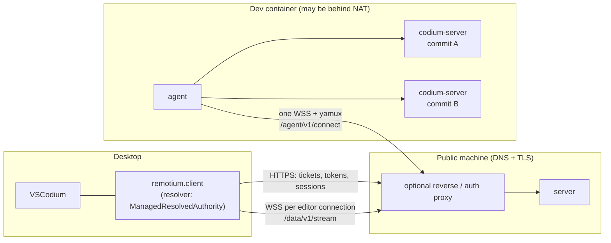
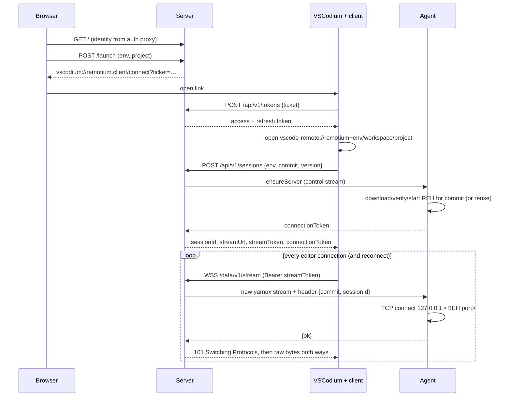

# Architecture

Both the editor and the dev container only make **outbound** connections. The server is the
only component that needs a public address.

## Launch flow

## Components

**Client** (`client/`). Registers the `remotium` remote authority resolver. `resolve()`
creates a session and returns `ManagedResolvedAuthority(makeConnection, connectionToken)`.
The editor calls `makeConnection` for every connection it needs (management, extension host,
each forwarded-port connection, every reconnect). Each call opens one binary WebSocket. The
editor runs its own protocol inside it, including the HTTP-upgrade handshake to the REH and
session resumption with replay of unacknowledged messages.

**Server** (`crates/server`). Control plane (`/`, `/launch`, `/api/v1/*`) and data plane
(`/data/*`, `/agent/*`), on one listener or two (`data_listen`). Keeps a registry of
connected agents (one per env), short-lived tickets, sessions and stream tokens in memory,
and client tokens (hashed) in `state_file`. For each client WebSocket it opens a yamux stream
to the env's agent *before* completing the upgrade, then copies bytes.

**Agent** (`crates/agent`). One persistent WSS to the server carrying yamux. The agent opens
stream 1 as the control stream; every other stream is opened by the server for one client
connection. The agent keeps one REH per editor commit:

- install from a read-only search path (pre-baked in the image) or download into
  `/data/servers/<commit>`, sha256-checked, extracted to a temp dir, commit verified, renamed
  into place; concurrent requests for one commit share one download,
- start on 127.0.0.1 with a connection token file (token kept across restarts),
- stop after `AGENT_IDLE_TIMEOUT_SECS` without connections, delete installs unused for
  `AGENT_REAP_AFTER_DAYS`.

REH processes run in their own process group and log to a file, so they outlive the agent.
A restarted agent adopts them from `server.json` (pid, port), and editor sessions continue.

## Reliability

- **Keepalive:** WebSocket pings every 25 s (configurable) on all hops, below common proxy
  idle timeouts. A link that receives nothing for 3–4 intervals, and doesn't answer a ping
  sent at least one interval earlier, is treated as dead. After our own process was stalled
  (e.g. a suspended Docker VM: a keepalive tick arrives far too late) the silence isn't held
  against the peer; frames already waiting are read first and a fresh ping is sent. The client
  drops a WebSocket that gets no pong for 40 s, so half-open connections (NAT, proxies,
  container restarts behind Docker's port proxy) are noticed quickly.
- **Agent link:** reconnects with jittered exponential backoff (1 s … 60 s). A newer
  connection for the same env replaces the old one.
- **Server restart:** client tokens survive (state file). Sessions don't. The client gets a 401
  on its next stream, creates a new session and reconnects, all within the editor's
  reconnection, without reloading the window.
- **Backpressure:** yamux per-stream flow control, with the link's receive window capped at
  `MAX_STREAMS × 256 KiB`, propagates through to TCP on both ends. A client that stops
  reading stalls its writer after a few MiB (see `backpressure_bounds_buffering`).
  `ManagedMessagePassing` has an optional `drain()`, which the client implements on top of
  `ws.bufferedAmount`.
