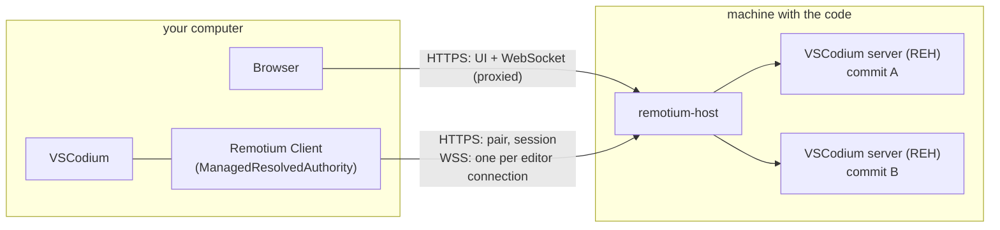

# Architecture

## remotium-host

- **HTTPS** with a self-signed certificate (fingerprint pinned by clients), your own
  certificate, or plain HTTP behind your proxy.
- **Pairing:** `remotium-host pair` creates a single-use code (10 minutes). A browser
  exchanges it for a device cookie, VSCodium for a device token. Only SHA-256 hashes are
  stored (`state.json`, shared by the running host and the CLI under a file lock).
- **VSCodium servers:** one per editor commit, from VSCodium's releases
  (`vscodium-reh-web-*`, which serves both desktop clients and the browser UI). Downloads
  are sha256-checked, extracted to a temp dir, checked for the requested commit and renamed
  into place. Servers listen on 127.0.0.1 with a connection token, run in their own process
  group, stop after 30 minutes without connections, and are adopted by a restarted host.
  Unused installs are deleted after 14 days.
- **Browser:** everything except `/pair` and `/remotium/*` needs the device cookie and is
  reverse-proxied (HTTP and WebSocket) to the server for the release pinned in
  `compat.json`.
- **Desktop:** `POST /remotium/v1/session` makes sure a server for the client's commit runs
  and returns its connection token; every editor connection is a WebSocket on
  `/remotium/v1/stream`, piped to that server's TCP port.

## Remotium Client

Registers the `remotium` remote authority resolver. `resolve()` calls the session endpoint
and returns `ManagedResolvedAuthority(makeConnection, connectionToken)`. The editor calls
`makeConnection` for every connection it needs (management, extension host, forwarded ports,
reconnects); each opens one WebSocket. The editor runs its own protocol inside, including the
handshake with the server and session resumption.

For self-signed hosts every HTTPS/WSS connection is checked against the paired certificate
fingerprint before a request is written.

If VSCodium doesn't allow the extension's proposed API yet, the extension still activates,
offers to add itself to `argv.json` and asks for a restart.

## Reliability

- WebSocket pings every 25 s. A peer is dead after silence plus an unanswered ping; after the
  host's own process was stalled (e.g. a suspended VM) it reads waiting frames first and
  probes again before giving up. The client drops a WebSocket with no pong for 40 s.
- A host restart doesn't stop the VSCodium servers, so editors and browsers reconnect into
  their running sessions.
- Backpressure is TCP's: the host copies between the WebSocket and the server's socket with
  bounded buffers, so a client that stops reading stalls its sender.
